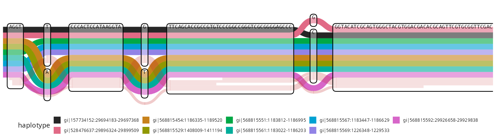
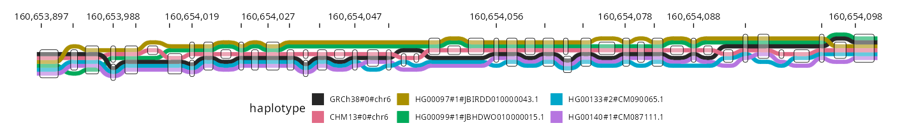
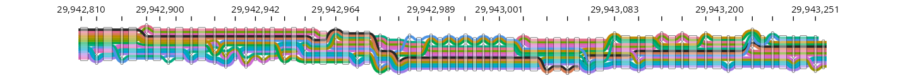
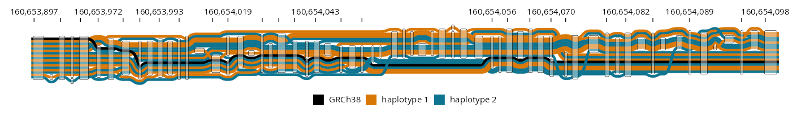
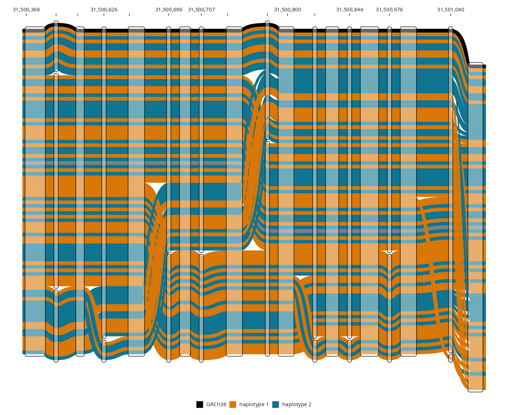
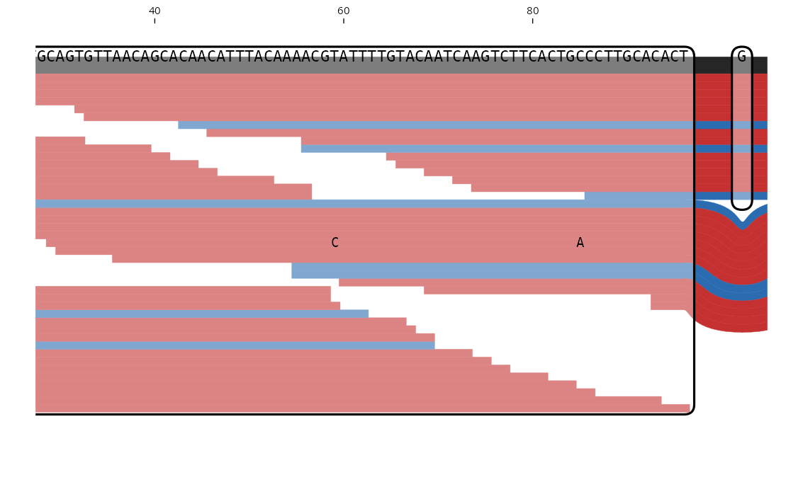
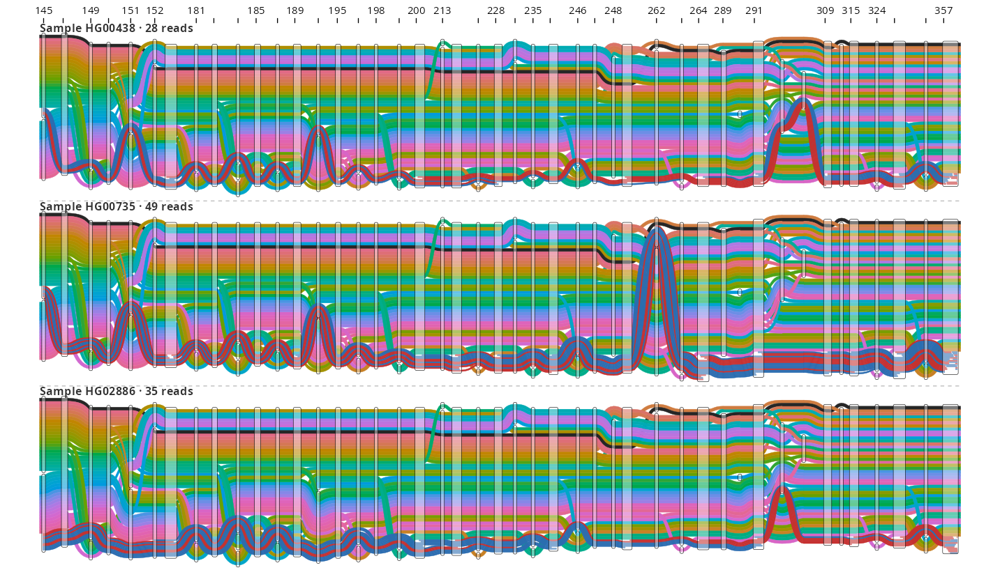
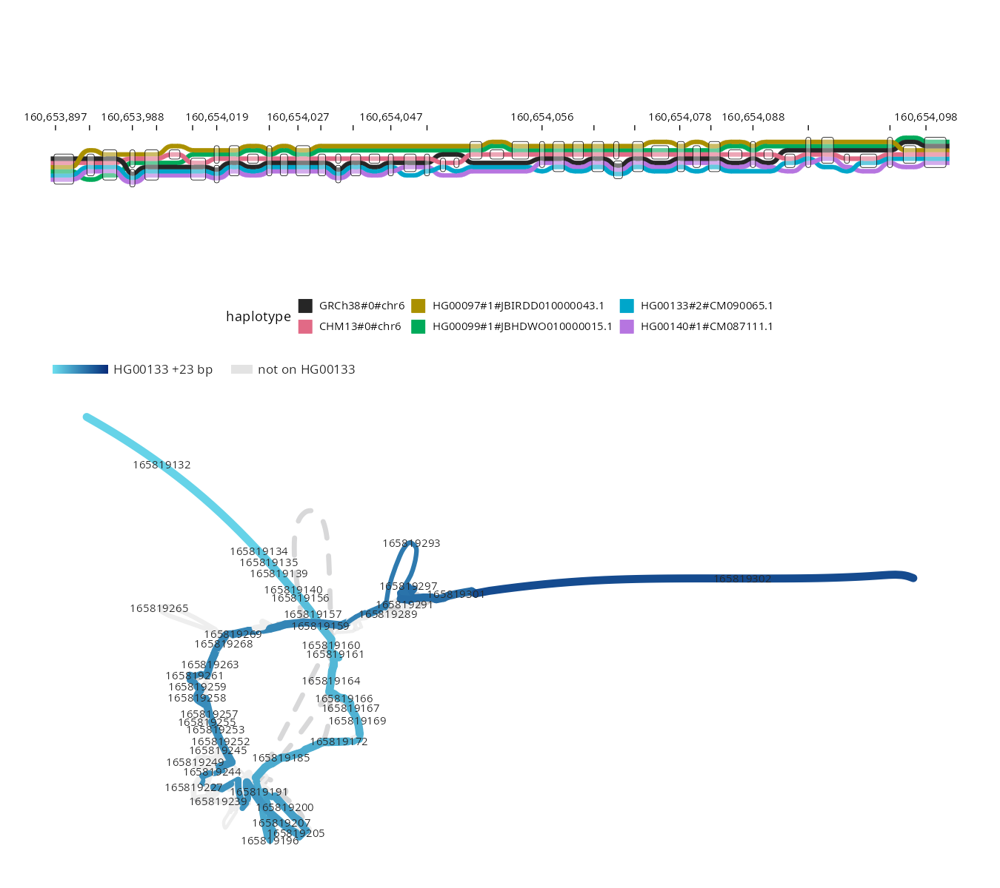

# ggtubemap

Pangenome graphs as tube maps, the view of
[sequenceTubeMap](https://github.com/vgteam/sequenceTubeMap), drawn with
ggplot2. The layout is sequenceTubeMap's own, from
[`@jbrowse/tubemap-core`](https://github.com/GMOD/tubemap-core), run in V8;
the drawing is ordinary ggplot2 layers, so a tube map takes scales, themes,
`patchwork` and vector output like any other plot.

- **In:** a GFA, sequenceTubeMap's extracted JSON, or a region of a
  [gfa-to-tabix](https://github.com/GMOD/gfa-to-tabix) walk file such as the
  HPRC release 2.1 graph's, read by range request
- **Out:** every tube, node outline, base and read mismatch as data frames,
  which `autoplot()` draws as sequenceTubeMap does

The package is not published yet, so install it from a checkout:

```r
devtools::install()
```

The [V8](https://cran.r-project.org/package=V8) package runs the layout, so
there is no Node or browser to install.

## Gallery

<table>
<tr><td width="50%"><b><a href="#usage">Nine assemblies, bases printed</a></b><br></td>
<td width="50%"><b><a href="#from-a-walk-file">A tandem repeat from the HPRC walk file</a></b><br></td></tr>
<tr><td width="50%"><b><a href="#from-a-walk-file">HLA-A in fourteen haplotypes</a></b><br></td>
<td width="50%"><b><a href="#from-a-walk-file">Sixteen haplotypes by phase</a></b><br></td></tr>
<tr><td width="50%"><b><a href="#colour-by-anything">91 haplotypes through MICB</a></b><br></td>
<td width="50%"><b><a href="#reads">Reads under BRCA1</a></b><br></td></tr>
<tr><td width="50%"><b><a href="#facets">43 mitochondria, a panel per sample</a></b><br></td>
<td width="50%"><b><a href="#with-ggbandage">With ggbandage's force layout</a></b><br></td></tr>
</table>

`tools/readme-figures.R` draws every figure.

## Usage

```r
library(ggtubemap)
library(ggplot2)

tm <- tubemap_layout(tubemap_example("example-6"))
autoplot(tm)
```


`tubemap_layout()` takes a graph, from `read_gfa()` or as a list of `nodes` and
`tracks`, and returns every tube, node outline, base and read mismatch as data
frames in layout pixels. `autoplot()` draws them in sequenceTubeMap's order.

```r
g <- read_gfa("graph.gfa", reference = "GRCh38#0#chr6")
tm <- tubemap_layout(g, node_width = "compressed")
```

`read_gfa()` reads `P` and `W` lines; walks get PanSN names,
`sample#haplotype#contig`.

### From a walk file

`read_gfa()` cuts a region out of a `gfa-to-tabix --walks` file, local or a
URL, with its `.tbi` beside it:

```r
walks <- "https://jbrowse.org/demos/hprc/hprc-v2.1-mc-grch38-f3.GRCh38.walks.bed.gz"
str <- read_gfa(
  walks,
  region = "chr6:160,653,940-160,654,130",
  haplotypes = c("CHM13#0", "HG00097#1", "HG00099#1", "HG00133#2", "HG00140#1")
)
autoplot(tubemap_layout(str, node_width = "compressed"))
```

- Range requests fetch only the blocks the region needs, from a 1.2 GB file:
  this cut takes about a second
- The reference sample's walk comes first; `haplotypes` picks the others by
  `sample#haplotype`, every one by default
- `chr6` names `GRCh38#0#chr6` where exactly one sequence ends that way
- [@jbrowse/graph-walks](https://github.com/GMOD/graph-walks) does the cut in
  V8, and R serves each byte range
- The HPRC file was built without `--sequences`, so its nodes have lengths but
  no bases to print

### Colour by anything

Each shape row has its track's `name`, `strand`, `mapping_quality`,
`sample_name`, `read_group` and `freq`. Add a column and map it:

```r
micb <- tubemap_layout(tubemap_example("micb-kir3dl1"), node_width = "compressed")
micb$shapes$phase <- sub("^[^#]+#([^#]+)#.*", "\\1", micb$shapes$name)
autoplot(micb, haplotypes = aes(fill = phase)) +
  scale_fill_manual(values = c("0" = "black", "1" = "#d97706", "2" = "#0e7490"))
```


Pass mappings through `autoplot()`'s `haplotypes` and `reads` arguments rather
than adding another tube layer, which would draw over the nodes. A `fill` on
the reads alone, such as `reads = aes(fill = mapping_quality)`, takes the fill
scale, and the haplotypes keep their default colours.

### Reads

Reads come with the graph in sequenceTubeMap's extracted form, as in the `brca1`
and `hprc-chrM` examples. `autoplot()` colours them by strand, fades them by
mapping quality, and marks their substitutions, deletions and insertions.
`xlim` and `ylim` zoom in by layout pixel:

```r
br <- tubemap_layout(tubemap_example("brca1"))
autoplot(br, xlim = c(250, 900))
```


### Ruler and positions

`autoplot()` draws a ruler along the top in the coordinates of the first track
with an `index_of_first_base`. `read_gfa()` gives every track one, taken from
a walk's start or from a path named `name[start-end]` or `name:start-end`, and
0 for other paths. Draw the ruler on a custom plot with `scale_x_tubemap(tm)`.

`tubemap_x()` turns positions on that track into layout x, to mark a region:

```r
micb <- tubemap_layout(tubemap_example("micb-kir3dl1"), node_width = "compressed")
autoplot(micb) +
  annotate("rect", xmin = tubemap_x(micb, 31500700), xmax = tubemap_x(micb, 31500800),
           ymin = -Inf, ymax = Inf, fill = "gold", alpha = 0.3)
```

### Facets

`facet_by` stacks one panel per `sample_name`, `read_group` or PanSN
`haplotype_sample`, every panel sharing the same x:

```r
chrm <- tubemap_layout(tubemap_example("hprc-chrM"),
                       node_width = "compressed", facet_by = "sample_name")
autoplot(chrm)
```


### With ggbandage

[ggbandage](https://github.com/GMOD/ggbandage) cuts the same walk file for its
Bandage-style layouts, and patchwork stacks the two:

```r
library(patchwork)
cut <- tempfile(fileext = ".gfa")
writeLines(
  ggbandage::bandage_gfa(walks, "chr6:160,653,940-160,654,130",
                         haplotypes = c("CHM13#0", "HG00097#1", "HG00099#1", "HG00133#2", "HG00140#1"),
                         context = 0),
  cut
)
g <- ggbandage::bandage_layout(cut, walks = "HG00133#2#CM090065.1", width = 600)
autoplot(tubemap_layout(str, node_width = "compressed")) / autoplot(g, labels = TRUE)
```

### Custom plots

`autoplot()` builds the plot from these layers, each taking the layout:

```r
ggplot() +
  geom_tubemap_haplotypes(tm) +
  geom_tubemap_reads(tm) +
  geom_tubemap_nodes(tm) +
  geom_tubemap_sequence(tm) +
  geom_tubemap_mismatches(tm) +
  coord_tubemap(tm) +
  theme_tubemap()
```

`coord_tubemap()` reverses the y scale and fixes the aspect ratio at 1, because
the layout's y runs downward and its curves assume square pixels.

## Output size

Text and node outlines are sized in layout pixels and scale with the plot, so a
map looks the same at any size. The text layers drop sequence that would print
smaller than 1.5 pt, as the viewer hides it when zoomed out.

`tubemap_size()` gives the inches at which the map prints at a chosen pixels per
inch; at the default 96 it matches sequenceTubeMap at 100%:

```r
size <- tubemap_size(tm, legend = 0.5)
ggsave("tubemap.pdf", autoplot(tm), width = size[["width"]],
       height = size[["height"]], device = cairo_pdf)
```

## Development

Git tracks the layout bundle `inst/js/tubemap-core.js`. `pnpm bundle` builds it
from `tools/bridge.js` and the `@jbrowse/tubemap-core` release pinned in
`package.json`, and writes that version into its header. The bundle also holds
`tools/walks.js`, the walk-file cut, with `@gmod/tabix` and
`@jbrowse/graph-walks`, and `tools/polyfills.js` for the web globals R's V8
lacks.

`pnpm update-core [version]` pins a tubemap-core release, the latest by default,
rebuilds the bundle, and copies that release's goldens into
`tests/testthat/golden` and its example graphs into `inst/extdata`.
`devtools::test()` then checks that V8 lays out exactly as Node does.

`pnpm update-deps [version]` runs `update-core`, then moves the other bundled
packages to their latest releases and the packages they depend on to the
newest their ranges allow, and lists what changed.

- The `Update bundled packages` workflow runs `update-deps` daily, committing
  to main when R CMD check passes
- `@jbrowse` releases go in the day they come out. Others wait three days,
  the `minimumReleaseAge` in `pnpm-workspace.yaml`
- The `Check` workflow runs R CMD check on every other push, and fails if
  `pnpm bundle` would change the tracked bundle

To try unreleased core changes, bundle from a checkout's source instead:

```sh
pnpm install
tools/bundle.sh ../tubemap-core
```

The header then holds the checkout's commit; `pnpm bundle` puts the release
back.

## See also

- [@jbrowse/tubemap-core](https://github.com/GMOD/tubemap-core) -
  sequenceTubeMap's layout, without the DOM
- [ggbandage](https://github.com/GMOD/ggbandage) - Bandage-style graph figures
  as ggplot2 layers
- [jbrowse-plugin-graphgenomeviewer](https://github.com/GMOD/jbrowse-plugin-graphgenomeviewer) -
  JBrowse 2 plugin that browses these graphs by locus
- [sequenceTubeMap, MemPanG26 edition](https://github.com/cmdcolin/sequenceTubeMap) -
  our fork of the tube map app

Tutorials on [jbrowse.org](https://jbrowse.org/jb2/docs/tutorials/)

- [HPRC part 1: graph alleles and haplotypes](https://jbrowse.org/jb2/docs/tutorials/pangenome_hprc/)
