# ggtubemap

Pangenome graphs as tube maps, the view of
[sequenceTubeMap](https://github.com/vgteam/sequenceTubeMap), drawn with
ggplot2. The layout is sequenceTubeMap's own, from
[`@jbrowse/tubemap-core`](https://github.com/GMOD/tubemap-core), run in V8;
the drawing is ordinary ggplot2 layers, so a tube map takes scales, themes,
`patchwork` and vector output like any other plot.

- **In:** a GFA, sequenceTubeMap's extracted JSON, or a region of a
  [gfa-to-tabix](https://github.com/GMOD/gfa-to-tabix) walk file such as the
  HPRC release 2.1 graph's, read by range request
- **Out:** every tube, node outline, base and read mismatch as data frames,
  which `autoplot()` draws as sequenceTubeMap does

The package is not on CRAN yet, so install it from GitHub:

```r
pak::pak("GMOD/ggtubemap")
```

The layout bundle is tracked in git and the
[V8](https://cran.r-project.org/package=V8) package runs it, so there is no
Node or browser to install.

## Gallery

<table>
<tr><td width="50%"><b><a href="#usage">Nine assemblies, bases printed</a></b><br>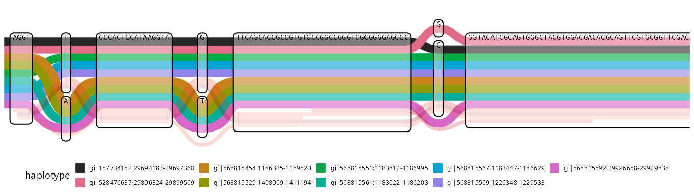</td>
<td width="50%"><b><a href="#from-a-walk-file">A tandem repeat from the HPRC walk file</a></b><br>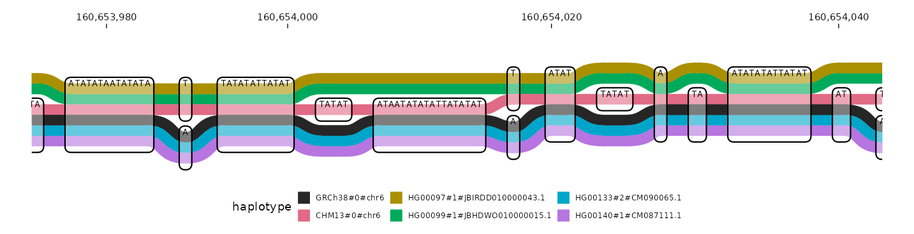</td></tr>
<tr><td width="50%"><b><a href="#from-a-walk-file">HLA-A in fourteen haplotypes</a></b><br>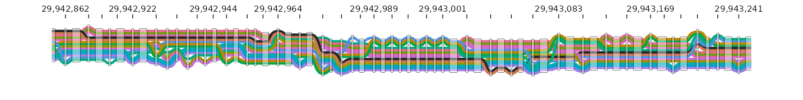</td>
<td width="50%"><b><a href="#colour-by-anything">Sixteen haplotypes by phase</a></b><br>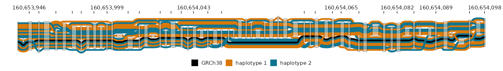</td></tr>
<tr><td width="50%"><b><a href="#colour-by-anything">91 haplotypes through MICB</a></b><br>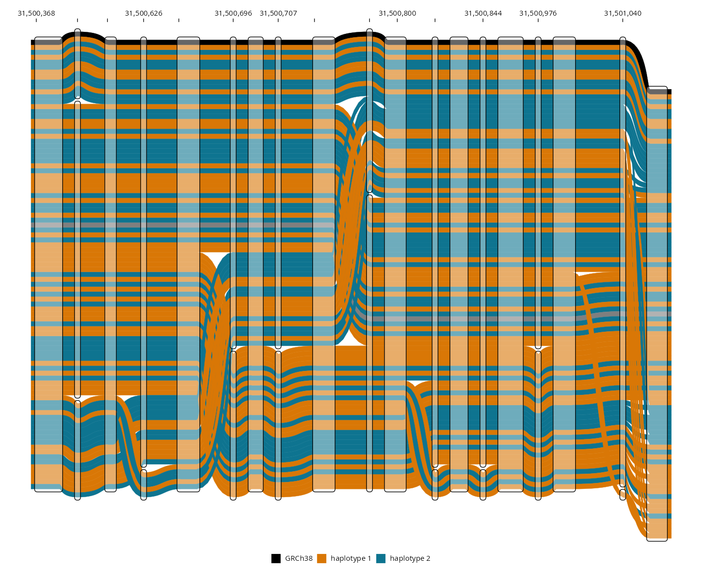</td>
<td width="50%"><b><a href="#reads">Reads under BRCA1</a></b><br>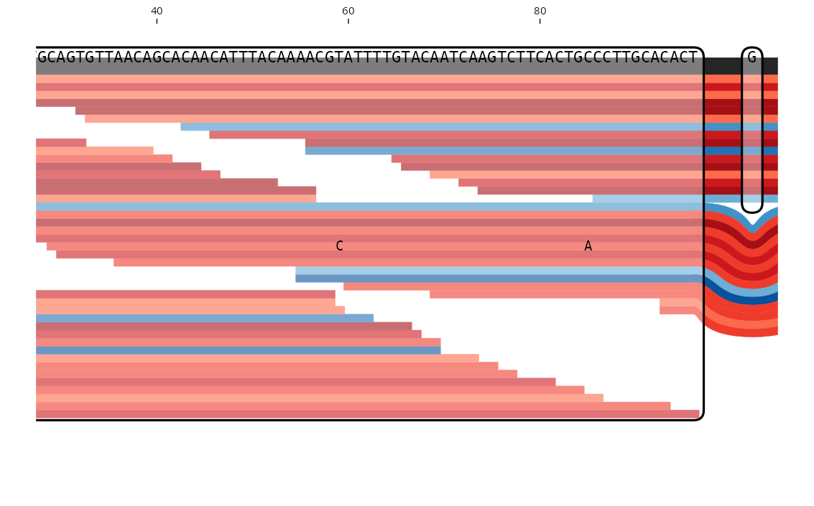</td></tr>
<tr><td width="50%"><b><a href="#facets">43 mitochondria, a panel per sample</a></b><br>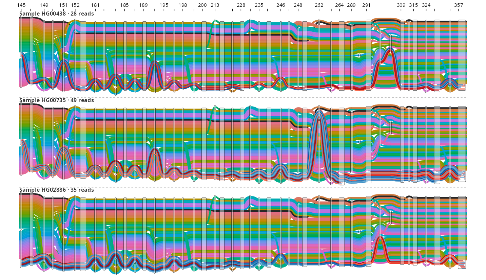</td>
<td width="50%"><b><a href="#with-ggbandage">With ggbandage's force layout</a></b><br>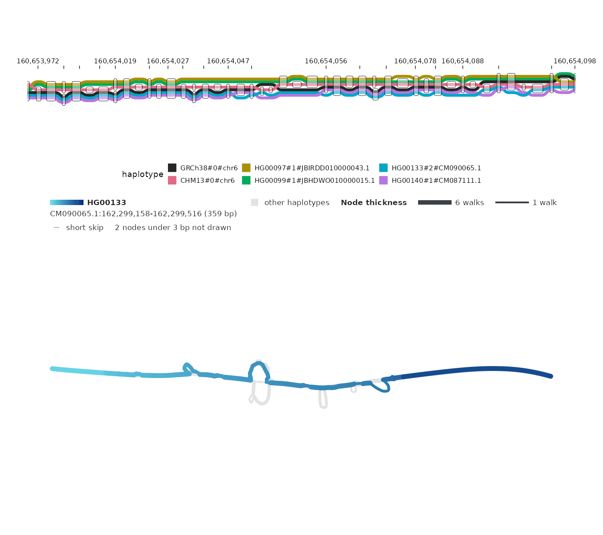</td></tr>
<tr><td width="50%"><b><a href="#fold-small-variants">A 45.5 kb deletion, small variants folded</a></b><br>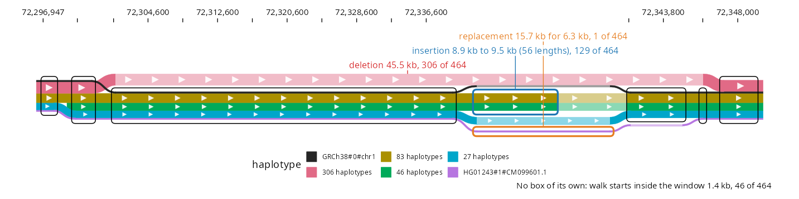</td>
<td width="50%"><b><a href="#fold-small-variants">A 16.6 kb inversion, folded</a></b><br>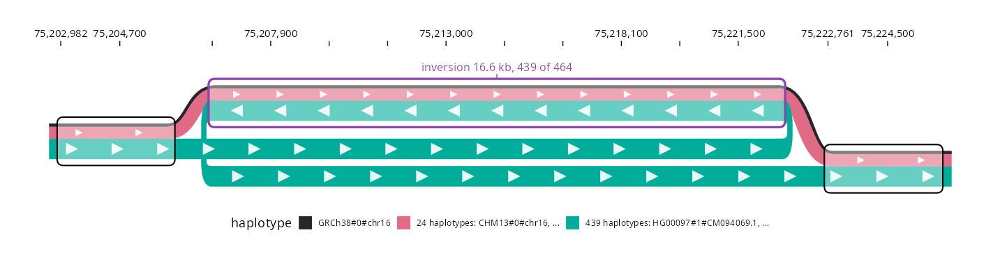</td></tr>
</table>

`tools/readme-figures.R` draws every figure.

## Usage

```r
library(ggtubemap)
library(ggplot2)

tm <- tubemap_layout(tubemap_example("example-6"))
autoplot(tm)
```


`tubemap_layout()` takes a graph, from `read_gfa()` or as a list of `nodes` and
`tracks`, and returns every tube, node outline, base and read mismatch as data
frames in layout pixels: `shapes` (the tubes), `nodes`, `outlines`, `bases`,
`mismatches`, `panels` and `ruler`. `autoplot()` draws them in
sequenceTubeMap's order.

`tubemap_example()` loads one of four bundled graphs: `example-6`, `brca1`,
`micb-kir3dl1` and `hprc-chrM`.

```r
g <- read_gfa("graph.gfa", reference = "GRCh38#0#chr6")
tm <- tubemap_layout(g, node_width = "compressed")
```

`read_gfa()` reads `P` and `W` lines; walks get PanSN names,
`sample#haplotype#contig`.

### From a walk file

A whole-genome pangenome is too large to load, so
[gfa-to-tabix](https://github.com/GMOD/gfa-to-tabix) indexes it once and
`read_gfa()` cuts one region at a time. A walk file is a `.walks.gz` with its
`.walks.gz.idx` directory beside it, local or a URL. It holds every
haplotype's walk, named in [PanSN](https://github.com/pangenome/PanSN-spec)
form, `sample#haplotype#contig`:

```console
vg convert -f graph.gbz > graph.gfa
gfa-to-tabix graph.gfa --walks --refs GRCh38 -o graph
```

That writes `graph.GRCh38.walks.gz`, in walk format 8. ggtubemap reads format
8 only, so rebuild an older walk file with gfa-to-tabix 5.0 or later.
JBrowse's
[Hosting your own graph](https://jbrowse.org/jb2/docs/tutorials/pangenome_prepare_graph/)
covers the steps, and ggbandage's
[Region-specific pangenomes](https://github.com/GMOD/ggbandage/blob/main/vignettes/region-pangenomes.Rmd)
the other kind of index. The JBrowse HPRC demo hosts the release 2.1 graph's
chr6, built with `--sequences` so its nodes print their bases:

```r
walks <- "https://jbrowse.org/demos/hprc/hprc-v2.1-mc-grch38-chr6-sequences-f8.GRCh38.walks.gz"
str <- read_gfa(
  walks,
  region = "chr6:160,653,940-160,654,130",
  haplotypes = c("CHM13#0", "HG00097#1", "HG00099#1", "HG00133#2", "HG00140#1")
)
tm <- tubemap_layout(str)
autoplot(tm, xlim = tubemap_x(tm, c(160653972, 160654042)))
```


- Range requests fetch only the blocks the region needs: this cut takes under
  a second
- The cut follows the browser readers' rules, those of BandageJS, the
  JBrowse graph plugin and sequenceTubeMap, by graph-walks' cut presets, so a
  region holds the same graph in each; `context` widens or narrows it
- The reference sample's walk comes first; `haplotypes` picks the others by
  `sample#haplotype`, every one by default
- A haplotype that takes no step on the reference over the region, such as one
  that jumps across it, has no track; a warning says where it leaves and
  rejoins the reference, and the map's caption names it
- `chr6` names the reference sample's sequence on it, `GRCh38#0#chr6`
- [@jbrowse/graph-walks](https://github.com/GMOD/graph-walks) does the cut in
  V8, and R serves each byte range
- At normal width the repeat is 6,200 layout pixels across, so `xlim` shows
  part of it, between two positions on GRCh38; `node_width = "compressed"` fits it whole, without bases
- The whole genome is in
  `https://jbrowse.org/demos/hprc/hprc-v2.1-mc-grch38-f8.GRCh38.walks.gz`,
  with the same nodes and walks but no bases

Twelve haplotypes through 400 bp of HLA-A, a bubble at nearly every node:

```r
samples <- c("HG00097", "HG00099", "HG00126", "HG00128", "HG00133", "HG002")
hla <- read_gfa(
  walks,
  region = "chr6:29,942,850-29,943,250",
  haplotypes = c("CHM13#0", paste0(rep(samples, each = 2), "#", 1:2))
)
hla_map <- tubemap_layout(hla, node_width = "compressed")
autoplot(hla_map, xlim = tubemap_x(hla_map, c(29942850, 29943250)))
```


### Fold small variants

A structural variant spans thousands of small bubbles, and at any width that
shows the bubbles it is off the page. Here are 51 kb of chr1 in the 464
haplotypes of the whole-genome file, banded with `coarsen = TRUE` because 464
tubes do not fit side by side. The layout is 1,889 nodes and 113,671 pixels
wide, so the first picture shows all of it at 1.2% and the second its first
1,700 pixels, about 850 bp, at the scale of the folded map below:

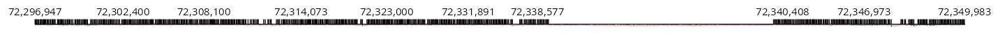

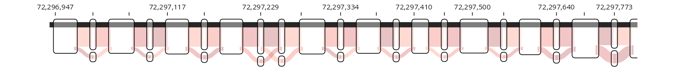

`fold` gives the size in bp at which a variant is kept.
[@jbrowse/graph-fold](https://github.com/GMOD/graph-fold) merges every smaller
bubble into the reference, so the nodes left are the stretches of reference
between the breakpoints of the variants kept, and haplotypes that then take
the same steps share one tube, as wide as the log of their count.

```r
genome <- "https://jbrowse.org/demos/hprc/hprc-v2.1-mc-grch38-f8.GRCh38.walks.gz"
del <- read_gfa(genome, region = "chr1:72,298,000-72,349,000",
                fold = 1000, cluster = TRUE)
autoplot(tubemap_layout(del))
```


- A folded graph is laid out at `node_width = "small"` and a scale that fits
  the window, here 49 bp to the pixel, so a node's width is its length;
  `bases_per_px` sets the scale
- `del$branches` has a row for each variant kept: `kind`, `length`,
  `inserted_bp`, `deleted_bp`, `ref_start`, `ref_end`, how many `haplotypes`
  of the `total` carry it, in which `tracks`, and the `label` drawn, which is
  graph-fold's text. `geom_tubemap_branches()` draws the labels, and
  `autoplot()` adds it
- `cluster = TRUE` draws alleles at one site whose lengths differ by at most
  5% as one branch. The insertion here is 56 lengths from 8.9 to 9.5 kb, and
  its label says so; without `cluster` each length is a box of its own
- A branch with no box or tube of its own, such as a walk that starts inside
  the window, is named in the caption
- A tube is solid where it reads a node and pale where it only passes one,
  as the deletion's is over the 39 kb it leaves out
- A tube stands for every haplotype that shares its route and orientation,
  not for identical ones, and the legend gives their count. `del$tubes`
  counts, for each, the distinct walks they took before folding and the
  least, median and most bp folded away in one

An inversion stays a block the walk takes in reverse. Of 464 haplotypes, 439
pass these 16.6 kb of chr16 against the reference: their tube runs under the
block to its far end, turns, comes back through it, turns again and goes on,
pale on the two passes under the block and solid on the pass back through it.
`geom_tubemap_direction()`, which `autoplot()` adds to a folded graph, points
an arrowhead along each tube the way its walk runs.

```r
inv <- read_gfa(genome, region = "chr16:75,204,000-75,225,000", fold = 1000)
autoplot(tubemap_layout(inv))
```


Before folding, this window is 1,653 nodes and 85,576 pixels wide. Its first
1,250 pixels are about 300 bp:

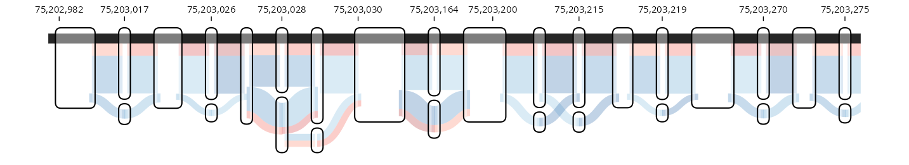

`inv$tubes` says what that tube hides: 439 haplotypes on 356 distinct walks,
8 bp to 795 bp folded away in each. 26 of them carry a 584 bp deletion that
`fold = 50` draws.

What `fold` does not do:

- It folds a graph whose reference passes each node once, as a
  Minigraph-Cactus graph's does. Where the reference passes a node twice, as
  in a pggb graph with a collapsed repeat, a run off the reference may be a
  copy of reference sequence, so `read_gfa()` warns with the reason and
  returns the graph unfolded
- Reads map to the graph's own nodes, which the fold merged, so
  `tubemap_layout()` drops the reads given with a folded graph and warns
- A haplotype that lies wholly inside an inversion takes every step in
  reverse, as does one written against the reference. The two cannot be told
  apart: neither is reported as an inversion, and both are drawn reversed
- A haplotype that leaves the window through a jump the cut holds no steps
  for is drawn stopping, as the branch `walk ends inside the window`
- Variants are not nested: one inside a kept insertion makes that insertion
  another allele
- An inversion the window cuts through is labelled as continuing past the
  window, and its length is the part inside
- `fold` needs `region` and a walk file, and folds onto the file's reference

### Colour by anything

Each shape row has its track's `name`, `strand`, `mapping_quality`,
`sample_name`, `read_group` and `freq`. Add a column and map it:

```r
micb <- tubemap_layout(tubemap_example("micb-kir3dl1"), node_width = "compressed")
micb$shapes$phase <- sub("^[^#]+#([^#]+)#.*", "\\1", micb$shapes$name)
autoplot(micb, haplotypes = aes(fill = phase)) +
  scale_fill_manual(values = c("0" = "black", "1" = "#d97706", "2" = "#0e7490"))
```


The same works on a cut from a walk file, here eight samples' sixteen
haplotypes through the tandem repeat:

```r
samples <- c(samples, "HG00140", "HG00146")
phased <- tubemap_layout(
  read_gfa(walks, region = "chr6:160,653,940-160,654,130",
           haplotypes = paste0(rep(samples, each = 2), "#", 1:2)),
  node_width = "compressed"
)
phased$shapes$phase <- sub("^[^#]+#([^#]+)#.*", "\\1", phased$shapes$name)
autoplot(phased, haplotypes = aes(fill = phase),
         xlim = tubemap_x(phased, c(160653940, 160654130))) +
  scale_fill_manual(values = c("0" = "black", "1" = "#d97706", "2" = "#0e7490"))
```


Pass mappings through `autoplot()`'s `haplotypes` and `reads` arguments rather
than adding another tube layer, which would draw over the nodes. A `fill` on
the reads alone, such as `reads = aes(fill = mapping_quality)`, takes the fill
scale, and the haplotypes keep their default colours.

### Reads

Reads come with the graph in sequenceTubeMap's extracted form, as in the `brca1`
and `hprc-chrM` examples. `autoplot()` colours forward reads red and reverse
reads blue, as JBrowse's alignments track does, fades them by mapping quality,
and marks their substitutions, deletions and insertions.
`xlim` and `ylim` zoom in by layout pixel:

```r
br <- tubemap_layout(tubemap_example("brca1"))
autoplot(br, xlim = c(250, 900))
```


### Ruler and positions

`autoplot()` draws a ruler along the top in the coordinates of the first track
with an `index_of_first_base`. `read_gfa()` gives every track one, taken from
a walk's start or from a path named `name[start-end]` or `name:start-end`, and
0 for other paths. Draw the ruler on a custom plot with `scale_x_tubemap(tm)`.

`tubemap_x()` turns positions on that track into layout x, to mark a region:

```r
micb <- tubemap_layout(tubemap_example("micb-kir3dl1"), node_width = "compressed")
autoplot(micb) +
  annotate("rect", xmin = tubemap_x(micb, 31500700), xmax = tubemap_x(micb, 31500800),
           ymin = -Inf, ymax = Inf, fill = "gold", alpha = 0.3)
```

### Facets

`facet_by` stacks one panel per `sample_name`, `read_group` or PanSN
`haplotype_sample`, every panel sharing the same x:

```r
chrm <- tubemap_layout(tubemap_example("hprc-chrM"),
                       node_width = "compressed", facet_by = "sample_name")
autoplot(chrm)
```


### With ggbandage

[ggbandage](https://github.com/GMOD/ggbandage) cuts the same walk file for its
Bandage-style layouts, and patchwork stacks the two. This reuses `walks` and
`str` from [From a walk file](#from-a-walk-file):

```r
library(patchwork)
cut <- tempfile(fileext = ".gfa")
writeLines(
  ggbandage::bandage_gfa(walks, "chr6:160,653,940-160,654,130",
                         haplotypes = c("CHM13#0", "HG00097#1", "HG00099#1", "HG00133#2", "HG00140#1"),
                         context = 0),
  cut
)
g <- ggbandage::bandage_layout(cut, walks = "HG00133#2#CM090065.1", width = 600)
tm <- tubemap_layout(str, node_width = "compressed")
autoplot(tm, xlim = tubemap_x(tm, c(160653940, 160654130))) / autoplot(g)
```


### Custom plots

`autoplot()` builds the plot from these layers, each taking the layout:

```r
ggplot() +
  geom_tubemap_haplotypes(tm) +
  geom_tubemap_reads(tm) +
  geom_tubemap_nodes(tm) +
  geom_tubemap_sequence(tm) +
  geom_tubemap_mismatches(tm) +
  geom_tubemap_branches(tm) +
  coord_tubemap(tm) +
  theme_tubemap()
```

`coord_tubemap()` reverses the y scale and fixes the aspect ratio at 1, because
the layout's y runs downward and its curves assume square pixels.

## Output size

Text and node outlines are sized in layout pixels and scale with the plot, so a
map looks the same at any size. The text layers drop sequence that would print
smaller than 1.5 pt, as the viewer hides it when zoomed out.

`tubemap_size()` gives the inches at which the map prints at a chosen pixels per
inch; at the default 96 it matches sequenceTubeMap at 100%:

```r
size <- tubemap_size(tm, legend = 0.5)
ggsave("tubemap.pdf", autoplot(tm), width = size[["width"]],
       height = size[["height"]], device = cairo_pdf)
```

## Development

The layout bundle, the files shared with ggbandage and the update workflows
are described in [DEVELOPMENT.md](DEVELOPMENT.md).

## See also

- [@jbrowse/tubemap-core](https://github.com/GMOD/tubemap-core) -
  sequenceTubeMap's layout, without the DOM
- [ggbandage](https://github.com/GMOD/ggbandage) - Bandage-style graph figures
  as ggplot2 layers
- [jbrowse-plugin-graphgenomeviewer](https://github.com/GMOD/jbrowse-plugin-graphgenomeviewer) -
  JBrowse 2 plugin that browses these graphs by locus
- [sequenceTubeMap, MemPanG26 edition](https://github.com/cmdcolin/sequenceTubeMap) -
  our fork of the tube map app

Tutorials on [jbrowse.org](https://jbrowse.org/jb2/docs/tutorials/)

- [HPRC part 1: graph alleles and haplotypes](https://jbrowse.org/jb2/docs/tutorials/pangenome_hprc/)
